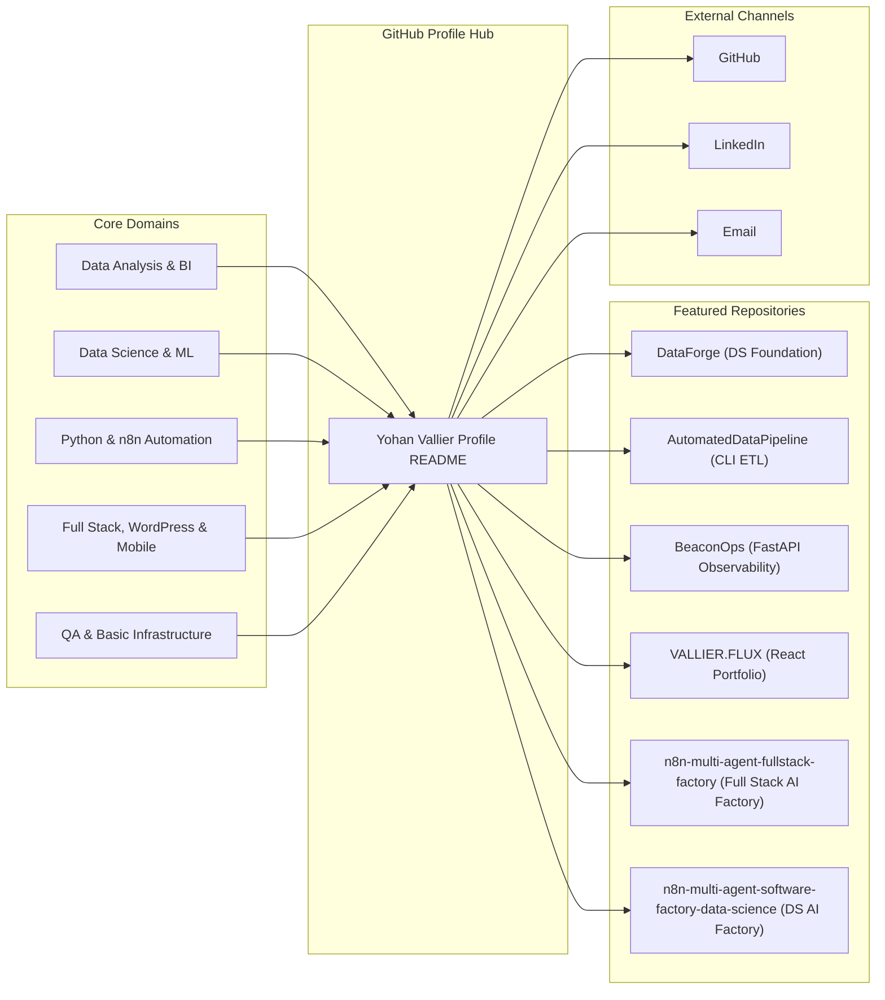
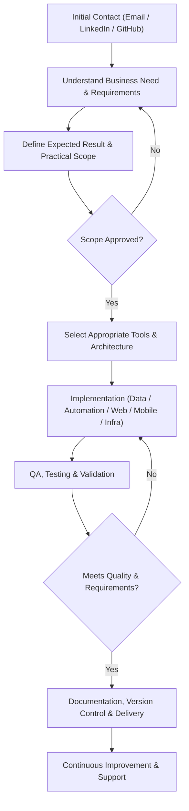
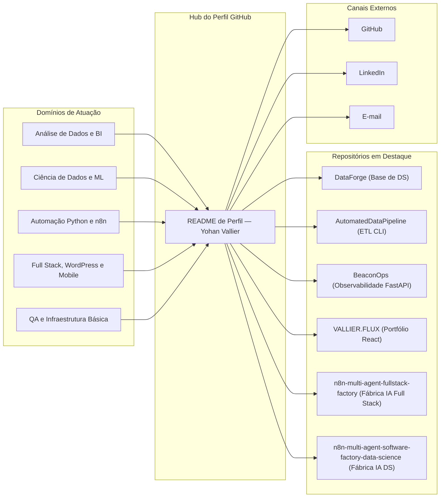
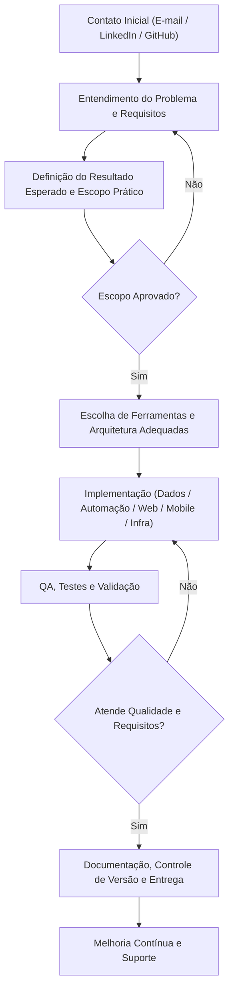

<div align="center">

# Yohan Vallier

[](#) [](#) [](#) [](#) [](#)

[](#) [](#) [](#)

**Language / Idioma:** [English](#english) | [Português (Brasil)](#português-brasil)

</div>

---

## English

### Table of Contents

- [1.1. Project Overview](#11-project-overview)
- [1.2. Preview / Visual Showcase](#12-preview--visual-showcase)
- [1.3. Key Features](#13-key-features)
- [1.4. Architecture](#14-architecture)
- [1.5. Technologies Used](#15-technologies-used)
- [1.6. Project Structure](#16-project-structure)
- [1.7. Installation](#17-installation)
- [1.8. Configuration](#18-configuration)
- [1.9. Usage](#19-usage)
- [1.10. Workflow / Execution Flow](#110-workflow--execution-flow)
- [1.11. Testing](#111-testing)
- [1.12. Future Improvements](#112-future-improvements)
- [1.13. Contributing](#113-contributing)
- [1.14. License](#114-license)
- [1.15. Author](#115-author)

---

### 1.1. Project Overview

This repository serves as the professional GitHub Profile README for **Yohan Vallier**, a Data Science student and developer working across **Data Science, Automation, and Full Stack & Web Development**.

It presents practical digital solutions spanning data pipelines, business intelligence reports, Python process automation, multi-agent AI workflows orchestrated with n8n, responsive websites, landing pages, WordPress adjustments, mobile features, quality assurance (QA), and basic infrastructure setup. The work focuses on combining data, software development, and technology to solve real problems with organized, maintainable, and scope-appropriate solutions.

| Attribute | Description |
| :--- | :--- |
| **Profile Owner** | Yohan Vallier |
| **Core Focus** | Data Science, Python & n8n Automation, and Full Stack & Web Development |
| **Location** | Brazil |
| **Availability** | Open for remote freelance projects in Brazil and worldwide |
| **Core Values** | Clear communication, readable code, documentation, version control, and scope-appropriate solutions |

---

### 1.2. Preview / Visual Showcase

<div align="center">
  
</div>

*Turning data into insights and ideas into practical digital solutions.*

---

### 1.3. Key Features

#### Core Service & Technical Domains

| Domain | Capabilities |
| :--- | :--- |
| **Data Analysis & Business Intelligence** | Data cleaning, validation, preprocessing, and transformation; Exploratory Data Analysis (EDA); consolidation from Excel, CSV, and other sources; handling missing values, duplicates, and inconsistent records; data aggregation, KPIs, and business indicators; Power BI and Excel reports/dashboards; SQL queries and data preparation. |
| **Python Automation & Workflow Optimization** | Python scripts for repetitive/operational tasks; Excel and CSV spreadsheet automation; automated file organization, reading, and processing; web scraping and data collection; browser automation with Playwright and Selenium; API requests and integrations; n8n workflow orchestration; automated data pipelines; logging, error handling, and execution monitoring. |
| **Data Science & Machine Learning** | Data preparation and feature exploration; statistical and exploratory analysis; numerical computing with NumPy and manipulation with Pandas; Machine Learning fundamentals and model workflows; experimentation and evaluation with Scikit-learn; dataset preparation for training and testing; result interpretation and communication. |
| **Front-End & Full Stack Web Development** | Responsive pages and interfaces with HTML, CSS, and JavaScript; interactive UIs and reusable components with React; front-end and back-end feature development; PHP server-side logic and form processing; API consumption and component integration; maintenance, bug fixing, and UI improvements; basic accessibility, usability, and SEO considerations. |
| **Landing Pages & WordPress** | Responsive landing pages with structured sections, calls to action, and contact forms; adjustments to existing WordPress websites and themes; layout, styling, content, and responsive fixes; basic plugin configuration and troubleshooting; form and third-party service integrations when supported. |
| **Mobile Development** | Development of mobile application features and interfaces; adaptation of layouts and user experiences for mobile screens; implementation and improvement of functionality based on project requirements. |
| **Quality Assurance (QA) & Testing** | Functional and exploratory testing; regression checks after changes and fixes; responsive and cross-browser interface checks; reproduction, documentation, and reporting of bugs; basic test scenarios and checklists; test automation with Playwright and Pytest when appropriate. |
| **Basic Infrastructure & Development Setup** | Initial setup of development environments and dependencies; basic hosting/server configuration and deployment; environment variables and configuration files; Git and GitHub repository setup and workflows; Docker and Linux fundamentals; basic troubleshooting and deployment support. |
| **Python Development** | Modular architecture and separation of responsibilities; Object-Oriented Programming (OOP); reusable functions, classes, and components; type hints and documentation; environment and dependency management; configuration via environment variables; logging, exception handling, automated testing, and Git version control. |

#### Featured Repositories

| Project | Purpose | Key Highlights | Repository |
| :--- | :--- | :--- | :--- |
| **DataForge** | Modular, reusable foundation for Data Science projects | Modular Python architecture; data loading, cleaning, and preprocessing utilities; ML training/evaluation structure; ETL components; Matplotlib, Seaborn, and Plotly utilities; centralized config, logging, and exception handling; Pytest and GitHub Actions CI. | [YohanVallier/DataForge](https://github.com/YohanVallier/DataForge) |
| **AutomatedDataPipeline** | Python CLI pipeline for multi-branch sales and inventory consolidation | Reads `.xlsx` and `.csv` files; normalizes column names and data types; handles missing values and critical records; consolidates datasets with Pandas; generates multi-worksheet Excel reports with OpenPyXL; logging, env vars, unit tests, and GitHub Actions CI. Designed to address manual consolidation taking ~8 hours/week. | [YohanVallier/AutomatedDataPipeline](https://github.com/YohanVallier/AutomatedDataPipeline) |
| **BeaconOps** | Self-hosted HTTP API monitoring and observability platform | FastAPI REST API with Pydantic validation; APScheduler with concurrency limits; async HTTPX requests with timeout/error handling; SQLAlchemy (SQLite default, PostgreSQL supported); consecutive-failure incident detection and recovery thresholds; Webhook notifications; operational metrics (uptime, downtime, avg/max latency, failures, recovery time); security validation, redirect/size limits, API-key admin protection; Pytest, Ruff, MyPy, Docker, Docker Compose, GitHub Actions. Scope: REST API only (no frontend dashboard in current MVP). | [YohanVallier/BeaconOps](https://github.com/YohanVallier/BeaconOps) |
| **VALLIER.FLUX** | Professional portfolio website | Black-and-purple technology-oriented visual identity; typed local content modules (no backend required); responsive component-based UI; docs covering env config, customization, validation, and deployment; optional external Formspree contact-form integration documented; Vitest, Testing Library, Playwright, axe, and Lighthouse CI declared. | [YohanVallier/VALLIERFLUX](https://github.com/YohanVallier/VALLIERFLUX) |
| **n8n Multi-Agent Fullstack Factory** | Multi-agent software factory for Full Stack development orchestrated with n8n | Orchestrates 14 LangChain agents (OpenAI and DeepSeek) across parallel workflows; integrates an auditing, testing, and automated `.zip` packaging pipeline; maintains architectural consistency through persistent state management and automated documentation. | [YohanVallier/n8n-multi-agent-fullstack-factory](https://github.com/YohanVallier/n8n-multi-agent-fullstack-factory) |
| **n8n Multi-Agent Software Factory — Data Science** | Multi-agent software factory for Data Science orchestration with n8n | Coordinates 9 specialized agents powered by OpenAI and DeepSeek; emphasizes FinOps guardrails and modular execution; automates Data Science development, review, documentation, and delivery with persistent state management for architectural consistency. | [YohanVallier/n8n-multi-agent-software-factory-data-science](https://github.com/YohanVallier/n8n-multi-agent-software-factory-data-science) |

#### Development Principles

- **Problem-first approach:** Understand the business need before choosing the technology.
- **Readable code:** Use clear naming, modular components, and consistent conventions.
- **Responsive experience:** Consider different screen sizes and usage contexts.
- **Separation of concerns:** Organize code by responsibility.
- **Reliability:** Include validation, testing, exception handling, and logging where appropriate.
- **Reproducibility:** Document dependencies, configuration, and execution steps.
- **Version control:** Track changes and maintain project history with Git.
- **Continuous improvement:** Review solutions and look for ways to make them more effective.

---

### 1.4. Architecture

This GitHub Profile acts as a central portfolio hub connecting core technical domains, reusable technology stacks, standalone open-source repositories, and freelance delivery channels.



| Layer | Responsibility |
| :--- | :--- |
| **Core Domains** | Defines technical capabilities across data, automation, web/mobile development, QA, and infrastructure setup. |
| **GitHub Profile Hub** | Centralizes developer positioning, technology stack overview, development principles, and freelance service catalog. |
| **Featured Repositories** | Demonstrates practical engineering implementations across Data Science, ETL pipelines, backend observability, frontend web architecture, and multi-agent n8n AI software factories. |
| **External Channels** | Provides direct access for recruiters, businesses, entrepreneurs, and international freelance collaboration. |

---

### 1.5. Technologies Used

The stack below reflects tools used across projects, practical familiarity, or ongoing learning. Experience level varies by tool, and the stack continues to expand.

| Category | Technologies & Tools |
| :--- | :--- |
| **Programming Languages & Web** | Python, SQL, JavaScript, PHP, HTML5, CSS3, React, WordPress |
| **Backend & API Development** | FastAPI, Pydantic, HTTPX, Uvicorn, APScheduler |
| **Python — Data Analysis & Processing** | Pandas, NumPy, OpenPyXL, SQLAlchemy, PyArrow |
| **Data Visualization & BI** | Power BI, Matplotlib, Seaborn, Plotly, Excel |
| **Machine Learning** | Scikit-learn, XGBoost |
| **Automation, APIs & Web Collection** | Playwright, Selenium, Requests, BeautifulSoup, n8n |
| **Databases, Infrastructure & Quality** | PostgreSQL, Streamlit, Docker, Git, GitHub, Linux, Pytest, GitHub Actions |
| **Other Areas** | Mobile Development, Landing Pages, WordPress Maintenance, QA Testing, Basic Infrastructure Setup |
| **Additional Tools Mentioned in Featured Projects** | SQLite, python-dotenv, Ruff, MyPy, TypeScript, React 19, Vite 7, CSS Modules, CSS variables, Lucide React, Vitest, Testing Library, axe, Lighthouse CI, Formspree (optional external integration), LangChain, OpenAI, DeepSeek |

> **Note:** `SQLite`, `python-dotenv`, `Ruff`, `MyPy`, `TypeScript`, `Vite 7`, `CSS Modules`, `CSS variables`, `Lucide React`, `Vitest`, `Testing Library`, `axe`, `Lighthouse CI`, `Formspree`, `LangChain`, `OpenAI`, and `DeepSeek` are associated with the Featured Projects and were not listed in the original Technologies & Tools badge section. They are documented separately above to preserve technical fidelity.

---

### 1.6. Project Structure

> **Note:** The original documentation does not specify a repository directory tree, as this file is a GitHub Profile README. The structure below reflects only the documentation file and the standardized banner path required by this template.

```text
YohanVallier/
├── assets/
│   └── images/
│       └── project-banner.png
└── README.md
```

| Path | Description |
| :--- | :--- |
| `README.md` | Bilingual GitHub Profile documentation (English and Português - Brasil). |
| `assets/images/project-banner.png` | Visual banner displayed in the Preview / Visual Showcase sections. |

---

### 1.7. Installation

No local installation procedure was specified in the original documentation because this repository functions as a GitHub Profile README rendered directly on GitHub (`github.com/YohanVallier`) rather than an installable software package.

To inspect or execute any of the featured technical solutions, refer to the individual repository documentation:

- [DataForge](https://github.com/YohanVallier/DataForge)
- [AutomatedDataPipeline](https://github.com/YohanVallier/AutomatedDataPipeline)
- [BeaconOps](https://github.com/YohanVallier/BeaconOps)
- [VALLIER.FLUX](https://github.com/YohanVallier/VALLIERFLUX)
- [n8n-multi-agent-fullstack-factory](https://github.com/YohanVallier/n8n-multi-agent-fullstack-factory)
- [n8n-multi-agent-software-factory-data-science](https://github.com/YohanVallier/n8n-multi-agent-software-factory-data-science)

---

### 1.8. Configuration

No environment variables or configuration files were specified for this GitHub Profile repository in the original documentation.

Configuration mechanisms explicitly referenced across the featured projects are summarized below for traceability:

| Referenced Project | Documented Configuration Mechanism |
| :--- | :--- |
| **AutomatedDataPipeline** | Environment variables via `python-dotenv`. |
| **BeaconOps** | SQLite (default) or PostgreSQL database via SQLAlchemy, configurable concurrency limits (APScheduler), Webhook endpoints, API-key protection for administrative endpoints, and Docker / Docker Compose setup. |
| **VALLIER.FLUX** | Local typed content modules (no backend required); optional external Formspree contact-form integration requiring separate configuration and validation. |
| **n8n Multi-Agent Fullstack Factory** | n8n workflow orchestration with OpenAI and DeepSeek API integrations, persistent state handling, and automated `.zip` packaging (detailed credentials and setup steps are maintained in the project repository). |
| **n8n Multi-Agent Software Factory — Data Science** | n8n modular orchestration with OpenAI and DeepSeek API integrations, FinOps guardrails, and persistent state handling (detailed credentials and setup steps are maintained in the project repository). |

---

### 1.9. Usage

Because this document is a GitHub Profile README rather than a CLI or web service, no runtime execution commands were specified in the original documentation. Visitors, recruiters, and prospective clients can use this profile to review technical domains, inspect featured repositories, and initiate freelance collaborations.

#### Freelance Service Catalog

| Service | Examples |
| :--- | :--- |
| **Data cleaning & preparation** | Cleaning, standardizing, merging, and validating Excel or CSV datasets. |
| **Data analysis & BI** | Exploring datasets, identifying patterns, and preparing Power BI or Excel reports and dashboards. |
| **Python automation** | Automating repetitive tasks, files, spreadsheets, and routine workflows. |
| **Web scraping & browser automation** | Collecting publicly available web data and automating browser-based workflows with Playwright or Selenium. |
| **Workflow automation & integrations** | Connecting services, APIs, and business processes with Python and n8n. |
| **Front-end development** | Building and improving responsive interfaces with HTML, CSS, JavaScript, and React. |
| **Back-end development** | Implementing server-side features and form processing with PHP, plus API and database integrations. |
| **Landing pages** | Developing responsive landing pages with clear sections, calls to action, and contact forms. |
| **WordPress adjustments** | Updating layouts, styles, content, themes, and basic plugin settings on existing sites. |
| **Mobile development** | Developing or improving mobile application interfaces and features based on project scope. |
| **QA & testing** | Running functional and regression tests, checking responsive behavior, and documenting bugs. |
| **Basic infrastructure setup** | Preparing development environments, configuring basic hosting, and supporting application deployment. |

---

### 1.10. Workflow / Execution Flow

Every project starts by understanding the business problem and requirements, defining the expected outcome, and agreeing on a practical scope before selecting tools and implementation strategies.



---

### 1.11. Testing

No automated tests or test coverage percentages were specified for this GitHub Profile repository in the original documentation.

Across Yohan Vallier's documented QA practices and featured repositories, the following quality assurance and testing tools are explicitly referenced:

| Context | Testing & Quality Practices / Tools |
| :--- | :--- |
| **QA & Testing Services** | Functional and exploratory testing, regression checks, responsive and cross-browser checks, bug reproduction/documentation/reporting, basic test scenarios/checklists, Playwright, Pytest. |
| **DataForge** | Automated tests with Pytest and CI with GitHub Actions. |
| **AutomatedDataPipeline** | Unit tests with Pytest and CI with GitHub Actions. |
| **BeaconOps** | Automated tests with Pytest, code checks with Ruff and MyPy, and CI with GitHub Actions. |
| **VALLIER.FLUX** | Declared workflow tools: Vitest, Testing Library, Playwright, axe, and Lighthouse CI. |
| **n8n Multi-Agent Fullstack Factory** | Automated auditing and testing pipeline integrated prior to `.zip` packaging. |
| **n8n Multi-Agent Software Factory — Data Science** | Automated review steps and FinOps guardrails across modular workflow execution. |

---

### 1.12. Future Improvements

No formal roadmap or planned future improvements were specified for this GitHub Profile repository in the original documentation.

The original document notes only that:
- The technology stack continues to expand alongside ongoing learning and practical project work.
- Solutions are continuously reviewed for opportunities to become more effective.
- Within the featured project **BeaconOps**, a frontend dashboard is explicitly noted as not being part of the current MVP.

---

### 1.13. Contributing

No formal contribution guidelines (`CONTRIBUTING.md`, pull request workflow, or issue templates) were specified in the original documentation.

For project collaborations, freelance inquiries, or feedback regarding featured repositories, reach out directly through the contact channels listed in [Section 1.15](#115-author).

---

### 1.14. License

No software or documentation license was specified in the original documentation.

---

### 1.15. Author

**Yohan Vallier** — Data Science student and developer based in Brazil, available for remote freelance projects in Brazil and worldwide.

| Channel | Link |
| :--- | :--- |
| **GitHub** | [github.com/YohanVallier](https://github.com/YohanVallier) |
| **LinkedIn** | [linkedin.com/in/yohan-vallier-895a342b7](https://www.linkedin.com/in/yohan-vallier-895a342b7/) |
| **Email** | [yohanvallier01@gmail.com](mailto:yohanvallier01@gmail.com) |

---

## Português (Brasil)

### Índice

- [2.1. Visão Geral do Projeto](#21-visão-geral-do-projeto)
- [2.2. Demonstração Visual](#22-demonstração-visual)
- [2.3. Principais Funcionalidades](#23-principais-funcionalidades)
- [2.4. Arquitetura](#24-arquitetura)
- [2.5. Tecnologias Utilizadas](#25-tecnologias-utilizadas)
- [2.6. Estrutura do Projeto](#26-estrutura-do-projeto)
- [2.7. Instalação](#27-instalação)
- [2.8. Configuração](#28-configuração)
- [2.9. Uso](#29-uso)
- [2.10. Fluxo de Execução](#210-fluxo-de-execução)
- [2.11. Testes](#211-testes)
- [2.12. Melhorias Futuras](#212-melhorias-futuras)
- [2.13. Contribuição](#213-contribuição)
- [2.14. Licença](#214-licença)
- [2.15. Autor](#215-autor)

---

### 2.1. Visão Geral do Projeto

Este repositório funciona como o README profissional de perfil no GitHub de **Yohan Vallier**, estudante de Ciência de Dados e desenvolvedor com atuação em **Ciência de Dados, Automação e Desenvolvimento Full Stack e Web**.

O perfil apresenta soluções digitais práticas que abrangem pipelines de dados, relatórios de Business Intelligence, automação de processos com Python, fluxos multiagentes de IA orquestrados com n8n, sites responsivos, landing pages, ajustes em WordPress, funcionalidades mobile, garantia de qualidade de software (QA) e configurações básicas de infraestrutura. O foco está em combinar dados, desenvolvimento de software e tecnologia para resolver problemas reais com soluções organizadas, sustentáveis e adequadas ao escopo de cada projeto.

| Atributo | Descrição |
| :--- | :--- |
| **Responsável pelo Perfil** | Yohan Vallier |
| **Atuação Principal** | Ciência de Dados, Automação com Python e n8n e Desenvolvimento Full Stack e Web |
| **Localização** | Brasil |
| **Disponibilidade** | Aberto a projetos freelance remotos no Brasil e no exterior |
| **Valores Centrais** | Comunicação clara, código legível, documentação, controle de versão e soluções adequadas ao escopo |

> **Nota:** Na documentação original, a seção em português (`Sobre Mim`) apresentava uma versão resumida sem os blocos de Projetos em Destaque, Tecnologias e Ferramentas, Princípios de Desenvolvimento e a tabela completa de Serviços Freelance. Nesta versão padronizada, todo o conteúdo técnico foi espelhado integralmente em ambos os idiomas.

---

### 2.2. Demonstração Visual

<div align="center">
  
</div>

*Transformando dados em insights e ideias em soluções digitais práticas.*

---

### 2.3. Principais Funcionalidades

#### Áreas de Atuação e Competências Técnicas

| Área | Capacidades |
| :--- | :--- |
| **Análise de Dados e Business Intelligence** | Limpeza, validação, pré-processamento e transformação de dados; Análise Exploratória de Dados (EDA); consolidação de dados de Excel, CSV e outras fontes; tratamento de valores ausentes, duplicatas e registros inconsistentes; agregação de dados, KPIs e indicadores de negócio; relatórios e dashboards em Power BI e Excel; consultas SQL e preparação de dados. |
| **Automação com Python e Otimização de Fluxos** | Scripts Python para tarefas repetitivas e operacionais; automação de planilhas Excel e CSV; organização, leitura e processamento automatizado de arquivos; web scraping e coleta de dados; automação de navegador com Playwright e Selenium; requisições e integrações com APIs; orquestração de fluxos de trabalho com n8n; pipelines automatizados; logging, tratamento de erros e monitoramento de execução. |
| **Ciência de Dados e Machine Learning** | Preparação de dados e exploração de variáveis (features); análise estatística e exploratória; computação numérica com NumPy e manipulação de dados com Pandas; fundamentos de Machine Learning e fluxos de modelagem; experimentação e avaliação de modelos com Scikit-learn; preparação de conjuntos de dados para treino e teste; interpretação e comunicação de resultados. |
| **Desenvolvimento Front-End e Full Stack Web** | Páginas e interfaces responsivas com HTML, CSS e JavaScript; interfaces interativas e componentes reutilizáveis com React; desenvolvimento de funcionalidades front-end e back-end conforme requisitos; lógica de servidor e processamento de formulários em PHP; consumo e integração de APIs; manutenção de sites, correção de bugs e melhorias de interface; noções básicas de acessibilidade, usabilidade e SEO. |
| **Landing Pages e WordPress** | Criação e implementação de landing pages responsivas com seções estruturadas, chamadas para ação e formulários de contato; ajustes em sites e temas WordPress existentes; correções de layout, estilos, conteúdo e responsividade; configuração básica de plugins e solução de problemas; integração de formulários e serviços externos quando suportados pelo projeto. |
| **Desenvolvimento Mobile** | Desenvolvimento de funcionalidades e interfaces para aplicativos mobile; adaptação de layouts e experiências de uso para telas móveis; implementação e melhoria de recursos com base nos requisitos do projeto. |
| **Garantia de Qualidade (QA) e Testes** | Testes funcionais e exploratórios; verificações de regressão após alterações e correções; checagens de responsividade e compatibilidade entre navegadores; reprodução, documentação e registro de bugs; cenários básicos de teste e checklists; automação de testes com Playwright e Pytest quando aplicável. |
| **Infraestrutura Básica e Configuração de Ambiente** | Configuração inicial de ambientes de desenvolvimento e dependências; configuração básica de hospedagem/servidor e publicação de aplicações; variáveis de ambiente e arquivos de configuração; configuração e fluxos de repositórios Git e GitHub; fundamentos de Docker e Linux; suporte básico de implantação e solução de problemas. |
| **Desenvolvimento Python** | Arquitetura modular e separação de responsabilidades; Programação Orientada a Objetos (POO); funções, classes e componentes reutilizáveis; type hints e documentação; gestão de ambientes e dependências; configuração por variáveis de ambiente; logging, tratamento de exceções, testes automatizados e controle de versão com Git. |

#### Projetos em Destaque

| Projeto | Objetivo | Principais Destaques | Repositório |
| :--- | :--- | :--- | :--- |
| **DataForge** | Base modular e reutilizável para projetos de Ciência de Dados | Arquitetura modular em Python; utilitários de carga, limpeza e pré-processamento; estrutura de treino e avaliação de modelos de ML; componentes de pipeline ETL; utilitários de visualização com Matplotlib, Seaborn e Plotly; configuração centralizada, logging e tratamento de exceções; testes com Pytest e CI com GitHub Actions. | [YohanVallier/DataForge](https://github.com/YohanVallier/DataForge) |
| **AutomatedDataPipeline** | Pipeline CLI em Python para consolidação de vendas e estoque de múltiplas filiais | Leitura de arquivos `.xlsx` e `.csv`; normalização de colunas e tipos de dados; tratamento de valores ausentes e registros críticos; consolidação com Pandas; geração de relatórios Excel com múltiplas abas via OpenPyXL; logging, variáveis de ambiente, testes unitários e CI no GitHub Actions. Projetado para reduzir consolidações manuais de cerca de 8 horas por semana. | [YohanVallier/AutomatedDataPipeline](https://github.com/YohanVallier/AutomatedDataPipeline) |
| **BeaconOps** | Plataforma self-hosted de monitoramento e observabilidade de APIs HTTP | API REST em FastAPI com validação Pydantic; agendamentos via APScheduler com limite de concorrência; requisições assíncronas com HTTPX e tratamento de timeouts/erros; persistência com SQLAlchemy (SQLite padrão, suporte a PostgreSQL); detecção de incidentes por falhas consecutivas e limiares de recuperação; notificações via Webhook HTTP; métricas operacionais (uptime, downtime, latência média/máxima, falhas e tempo de recuperação); validação segura de URLs, restrições de redirecionamento e tamanho de resposta, proteção por API key em endpoints administrativos; Pytest, Ruff, MyPy, Docker, Docker Compose e GitHub Actions. Escopo: apenas API REST documentada (dashboard frontend não faz parte do MVP atual). | [YohanVallier/BeaconOps](https://github.com/YohanVallier/BeaconOps) |
| **VALLIER.FLUX** | Site de portfólio profissional | Identidade visual tecnológica em preto e roxo; conteúdo organizado em módulos locais tipados (sem necessidade de backend próprio); interface responsiva baseada em componentes; documentação de configuração de ambiente, personalização, validação e deploy; documentação do Formspree como integração externa opcional para formulário de contato; Vitest, Testing Library, Playwright, axe e Lighthouse CI declarados no fluxo do projeto. | [YohanVallier/VALLIERFLUX](https://github.com/YohanVallier/VALLIERFLUX) |
| **n8n Multi-Agent Fullstack Factory** | Fábrica de software multiagente para desenvolvimento Full Stack orquestrada com n8n | Orquestra 14 agentes LangChain (OpenAI e DeepSeek) em fluxos paralelos; integra pipeline de auditoria, testes e empacotamento automatizado em `.zip`; mantém consistência arquitetural por meio de estados persistentes e documentação automatizada. | [YohanVallier/n8n-multi-agent-fullstack-factory](https://github.com/YohanVallier/n8n-multi-agent-fullstack-factory) |
| **n8n Multi-Agent Software Factory — Data Science** | Fábrica de software multiagente para orquestração de projetos de Ciência de Dados com n8n | Coordena 9 agentes especializados com OpenAI e DeepSeek; foco em guardrails de FinOps e execução modular; automatiza desenvolvimento, revisão, documentação e entrega em Ciência de Dados com estados persistentes para consistência arquitetural. | [YohanVallier/n8n-multi-agent-software-factory-data-science](https://github.com/YohanVallier/n8n-multi-agent-software-factory-data-science) |

#### Princípios de Desenvolvimento

- **Foco no problema:** Entender a necessidade do negócio antes de escolher a tecnologia.
- **Código legível:** Utilizar nomenclatura clara, componentes modulares e convenções consistentes.
- **Experiência responsiva:** Considerar diferentes tamanhos de tela e contextos de uso.
- **Separação de responsabilidades:** Organizar o código de acordo com cada responsabilidade.
- **Confiabilidade:** Incluir validação, testes, tratamento de exceções e logging quando aplicável.
- **Reprodutibilidade:** Documentar dependências, configurações e etapas de execução.
- **Controle de versão:** Rastrear alterações e manter o histórico do projeto com Git.
- **Melhoria contínua:** Revisar soluções e buscar formas de torná-las mais eficazes.

---

### 2.4. Arquitetura

Este perfil no GitHub atua como um hub central de portfólio que conecta domínios técnicos, pilhas de tecnologias, repositórios independentes e canais de contato para projetos freelance.



| Camada | Responsabilidade |
| :--- | :--- |
| **Domínios de Atuação** | Define as frentes técnicas em dados, automação, desenvolvimento web/mobile, QA e infraestrutura básica. |
| **Hub do Perfil GitHub** | Centraliza o posicionamento profissional, o inventário tecnológico, os princípios de engenharia e o catálogo de serviços freelance. |
| **Repositórios em Destaque** | Comprova implementações práticas em Ciência de Dados, pipelines ETL, observabilidade backend, arquitetura frontend e fábricas de software multiagentes com n8n e IA. |
| **Canais Externos** | Viabiliza contato direto com recrutadores, empresas, empreendedores e clientes internacionais. |

---

### 2.5. Tecnologias Utilizadas

As tecnologias listadas refletem ferramentas usadas nos projetos, familiaridade prática ou aprendizado contínuo. O nível de experiência varia conforme a ferramenta e a stack continua em expansão.

| Categoria | Tecnologias e Ferramentas |
| :--- | :--- |
| **Linguagens de Programação e Web** | Python, SQL, JavaScript, PHP, HTML5, CSS3, React, WordPress |
| **Backend e Desenvolvimento de APIs** | FastAPI, Pydantic, HTTPX, Uvicorn, APScheduler |
| **Python — Análise e Processamento de Dados** | Pandas, NumPy, OpenPyXL, SQLAlchemy, PyArrow |
| **Visualização de Dados e BI** | Power BI, Matplotlib, Seaborn, Plotly, Excel |
| **Machine Learning** | Scikit-learn, XGBoost |
| **Automação, APIs e Coleta de Dados Web** | Playwright, Selenium, Requests, BeautifulSoup, n8n |
| **Bancos de Dados, Infraestrutura e Qualidade** | PostgreSQL, Streamlit, Docker, Git, GitHub, Linux, Pytest, GitHub Actions |
| **Outras Áreas** | Desenvolvimento Mobile, Landing Pages, Manutenção WordPress, Testes QA, Configuração Básica de Infraestrutura |
| **Ferramentas Adicionais Citadas nos Projetos em Destaque** | SQLite, python-dotenv, Ruff, MyPy, TypeScript, React 19, Vite 7, CSS Modules, variáveis CSS, Lucide React, Vitest, Testing Library, axe, Lighthouse CI, Formspree (integração externa opcional), LangChain, OpenAI, DeepSeek |

> **Nota:** `SQLite`, `python-dotenv`, `Ruff`, `MyPy`, `TypeScript`, `Vite 7`, `CSS Modules`, `variáveis CSS`, `Lucide React`, `Vitest`, `Testing Library`, `axe`, `Lighthouse CI`, `Formspree`, `LangChain`, `OpenAI` e `DeepSeek` estão associados aos Projetos em Destaque e não constavam na seção principal original de badges de Tecnologias e Ferramentas. Esses itens foram mantidos separadamente acima para preservar a fidelidade técnica.

---

### 2.6. Estrutura do Projeto

> **Nota:** A documentação original não especifica uma árvore de diretórios do repositório, pois este arquivo corresponde a um README de perfil do GitHub. A estrutura abaixo representa apenas o arquivo de documentação e o caminho padronizado do banner visual exigido por este modelo.

```text
YohanVallier/
├── assets/
│   └── images/
│       └── project-banner.png
└── README.md
```

| Caminho | Descrição |
| :--- | :--- |
| `README.md` | Documentação bilíngue de perfil no GitHub (English e Português - Brasil). |
| `assets/images/project-banner.png` | Banner visual exibido nas seções de Demonstração Visual. |

---

### 2.7. Instalação

Nenhum procedimento de instalação local foi especificado na documentação original, pois este repositório atua como um README de perfil exibido diretamente no GitHub (`github.com/YohanVallier`), e não como um pacote executável.

Para instalar ou executar qualquer um dos projetos técnicos apresentados, consulte a documentação individual de cada repositório:

- [DataForge](https://github.com/YohanVallier/DataForge)
- [AutomatedDataPipeline](https://github.com/YohanVallier/AutomatedDataPipeline)
- [BeaconOps](https://github.com/YohanVallier/BeaconOps)
- [VALLIER.FLUX](https://github.com/YohanVallier/VALLIERFLUX)
- [n8n-multi-agent-fullstack-factory](https://github.com/YohanVallier/n8n-multi-agent-fullstack-factory)
- [n8n-multi-agent-software-factory-data-science](https://github.com/YohanVallier/n8n-multi-agent-software-factory-data-science)

---

### 2.8. Configuração

Nenhuma variável de ambiente ou arquivo de configuração foi especificado para este repositório de perfil na documentação original.

Os mecanismos de configuração explicitamente referenciados nos projetos em destaque estão resumidos na tabela a seguir:

| Projeto Referenciado | Mecanismo de Configuração Documentado |
| :--- | :--- |
| **AutomatedDataPipeline** | Variáveis de ambiente com `python-dotenv`. |
| **BeaconOps** | Banco SQLite (padrão) ou PostgreSQL via SQLAlchemy, limites configuráveis de concorrência (APScheduler), endpoints de Webhook, proteção por API key para endpoints administrativos e suporte a Docker / Docker Compose. |
| **VALLIER.FLUX** | Módulos locais tipados de conteúdo (sem necessidade de backend); integração externa opcional com Formspree para formulário de contato, exigindo configuração e validação separadas. |
| **n8n Multi-Agent Fullstack Factory** | Orquestração de workflows n8n com integrações de APIs OpenAI e DeepSeek, gerenciamento de estado persistente e empacotamento automatizado em `.zip` (credenciais e passos detalhados são mantidos no repositório do projeto). |
| **n8n Multi-Agent Software Factory — Data Science** | Orquestração modular n8n com integrações de APIs OpenAI e DeepSeek, guardrails de FinOps e gerenciamento de estado persistente (credenciais e passos detalhados são mantidos no repositório do projeto). |

---

### 2.9. Uso

Por se tratar de um README de perfil do GitHub e não de uma aplicação CLI ou serviço web, nenhum comando de execução foi especificado na documentação original. Visitantes, recrutadores e clientes podem utilizar este documento para avaliar áreas de atuação, explorar repositórios em destaque e contratar serviços freelance.

#### Catálogo de Serviços Freelance

| Serviço | Exemplos |
| :--- | :--- |
| **Limpeza e preparação de dados** | Limpeza, padronização, unificação e validação de bases em Excel ou CSV. |
| **Análise de dados e BI** | Exploração de conjuntos de dados, identificação de padrões e criação de relatórios e dashboards em Power BI ou Excel. |
| **Automação com Python** | Automação de tarefas repetitivas, arquivos, planilhas e fluxos rotineiros. |
| **Web scraping e automação de navegador** | Coleta de dados públicos na web e automação de processos em navegadores com Playwright ou Selenium. |
| **Automação de fluxos e integrações** | Conexão entre serviços, APIs e processos de negócio com Python e n8n. |
| **Desenvolvimento front-end** | Criação e melhoria de interfaces responsivas com HTML, CSS, JavaScript e React. |
| **Desenvolvimento back-end** | Implementação de funcionalidades no servidor e processamento de formulários em PHP, além de integrações com APIs e bancos de dados. |
| **Landing pages** | Desenvolvimento de landing pages responsivas com seções claras, chamadas para ação e formulários de contato. |
| **Ajustes em WordPress** | Atualização de layouts, estilos, conteúdo, temas e configurações básicas de plugins em sites existentes. |
| **Desenvolvimento mobile** | Criação ou melhoria de interfaces e funcionalidades de aplicativos mobile conforme o escopo do projeto. |
| **QA e testes** | Execução de testes funcionais e de regressão, validação de responsividade e documentação de bugs. |
| **Configuração básica de infraestrutura** | Preparação de ambientes de desenvolvimento, configuração básica de hospedagem e suporte à publicação de aplicações. |

---

### 2.10. Fluxo de Execução

Todo projeto começa pela compreensão do problema e dos requisitos, definição do resultado esperado e alinhamento de um escopo prático antes da escolha das tecnologias e da implementação.



---

### 2.11. Testes

Nenhum teste automatizado ou percentual de cobertura foi especificado para este repositório de perfil na documentação original.

Nas práticas de QA e nos projetos em destaque documentados por Yohan Vallier, são citadas explicitamente as seguintes ferramentas e abordagens:

| Contexto | Práticas e Ferramentas de Teste e Qualidade |
| :--- | :--- |
| **Serviços de QA e Testes** | Testes funcionais e exploratórios, verificações de regressão, checagens de responsividade e entre navegadores, reprodução/documentação/registro de bugs, cenários básicos e checklists, Playwright e Pytest. |
| **DataForge** | Testes automatizados com Pytest e CI via GitHub Actions. |
| **AutomatedDataPipeline** | Testes unitários com Pytest e CI via GitHub Actions. |
| **BeaconOps** | Testes automatizados com Pytest, checagens de código com Ruff e MyPy, e CI via GitHub Actions. |
| **VALLIER.FLUX** | Ferramentas declaradas no fluxo do projeto: Vitest, Testing Library, Playwright, axe e Lighthouse CI. |
| **n8n Multi-Agent Fullstack Factory** | Pipeline automatizado de auditoria e testes integrado antes do empacotamento em `.zip`. |
| **n8n Multi-Agent Software Factory — Data Science** | Etapas automatizadas de revisão e guardrails de FinOps ao longo da execução modular dos fluxos. |

---

### 2.12. Melhorias Futuras

Nenhum roadmap formal ou plano de melhorias futuras foi especificado para este repositório de perfil na documentação original.

A documentação original menciona apenas que:
- A pilha tecnológica continua em expansão conforme o aprendizado contínuo e novos projetos.
- As soluções são revisadas continuamente em busca de maior efetividade.
- No projeto em destaque **BeaconOps**, um dashboard frontend é explicitamente indicado como fora do escopo do MVP atual.

---

### 2.13. Contribuição

Nenhuma diretriz formal de contribuição (`CONTRIBUTING.md`, fluxo de pull requests ou modelos de issues) foi especificada na documentação original.

Para colaborações em projetos, solicitações freelance ou feedback sobre os repositórios em destaque, utilize os canais de contato indicados na [Seção 2.15](#215-autor).

---

### 2.14. Licença

Nenhuma licença de software ou documentação foi especificada na documentação original.

---

### 2.15. Autor

**Yohan Vallier** — Estudante de Ciência de Dados e desenvolvedor baseado no Brasil, disponível para projetos freelance remotos no Brasil e no exterior.

| Canal | Link |
| :--- | :--- |
| **GitHub** | [github.com/YohanVallier](https://github.com/YohanVallier) |
| **LinkedIn** | [linkedin.com/in/yohan-vallier-895a342b7](https://www.linkedin.com/in/yohan-vallier-895a342b7/) |
| **E-mail** | [yohanvallier01@gmail.com](mailto:yohanvallier01@gmail.com) |