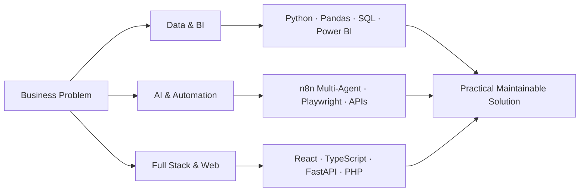
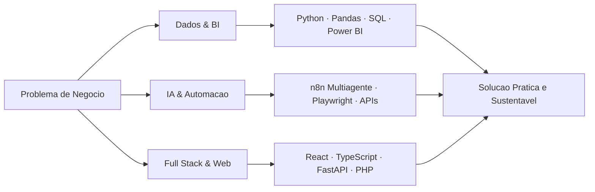

# Yohan Vallier

### Data Science · AI Automation · Full Stack & Web Development

  

**Combining data, AI automation, and software development to solve real problems with organized, maintainable solutions.**

 

 

-1F2937?style=flat-square)

---

## 👨‍💻 About Me

I'm a **Data Science student and developer** working across data analysis, Python automation, multi-agent AI workflow orchestration, and full stack development. I build solutions ranging from data pipelines, automated software factories, and business reports to responsive websites, landing pages, and application features.

On the **data & automation** side, I work with collecting, cleaning, transforming, exploring, and visualizing information, as well as orchestrating multi-agent pipelines in **n8n** with **OpenAI**, **DeepSeek**, and **Python**. On the **development** side, I use technologies such as **JavaScript, TypeScript, React, HTML, CSS, PHP, and FastAPI** to create and improve web experiences, while also exploring mobile development and practical software integrations.

I also work with WordPress adjustments, basic infrastructure setup, and software quality assurance (QA), including functional testing, troubleshooting, and bug reporting. I value clear communication, readable code, documentation, version control, and solutions tailored to each project's scope.

---

## 📈 GitHub Activity

 

---

## 🛠️ What I Can Help With

<table>
  <tr>
    <td width="50%" valign="top">
      <h3>📊 Data Analysis & Business Intelligence</h3>
      <ul>
        <li>Data cleaning, validation, preprocessing, and transformation.</li>
        <li>Exploratory Data Analysis (EDA) and KPIs / business indicators.</li>
        <li>Consolidation from Excel, CSV, and multi-branch sources.</li>
        <li>Reports and dashboards with Power BI and Excel.</li>
        <li>SQL queries and data preparation for reporting.</li>
      </ul>
    </td>
    <td width="50%" valign="top">
      <h3>🤖 Python Automation & Multi-Agent AI</h3>
      <ul>
        <li>Multi-agent LLM workflows and orchestration with <b>n8n</b>.</li>
        <li>Python scripts for operational and spreadsheet automation.</li>
        <li>Web scraping and browser automation (Playwright / Selenium).</li>
        <li>API integrations, webhooks, and automated ETL pipelines.</li>
        <li>Logging, error handling, FinOps guardrails, and monitoring.</li>
      </ul>
    </td>
  </tr>
  <tr>
    <td width="50%" valign="top">
      <h3>🧠 Data Science & Machine Learning</h3>
      <ul>
        <li>Data preparation, feature exploration, and statistical analysis.</li>
        <li>Numerical computing with NumPy and manipulation with Pandas.</li>
        <li>Machine Learning pipelines with Scikit-learn and XGBoost.</li>
        <li>Dataset preparation for training, testing, and evaluation.</li>
        <li>Clear interpretation and communication of results.</li>
      </ul>
    </td>
    <td width="50%" valign="top">
      <h3>🌐 Front-End & Full Stack Web Development</h3>
      <ul>
        <li>Responsive interfaces with HTML, CSS, JavaScript, and TypeScript.</li>
        <li>Reusable components and modern apps with React.</li>
        <li>REST APIs with FastAPI and server-side logic / forms with PHP.</li>
        <li>API consumption, database integration, and maintenance.</li>
        <li>Accessibility, usability, and foundational SEO practices.</li>
      </ul>
    </td>
  </tr>
  <tr>
    <td width="50%" valign="top">
      <h3>🚀 Landing Pages, WordPress & Mobile</h3>
      <ul>
        <li>Responsive landing pages with clear CTAs and contact forms.</li>
        <li>WordPress theme adjustments, styling, layout fixes, and plugins.</li>
        <li>Third-party form and service integrations.</li>
        <li>Mobile application features and screen-adapted UI layouts.</li>
      </ul>
    </td>
    <td width="50%" valign="top">
      <h3>🧪 QA, Testing & Basic Infrastructure</h3>
      <ul>
        <li>Functional, exploratory, regression, and cross-browser testing.</li>
        <li>Bug reproduction, documentation, and test automation (Playwright / Pytest).</li>
        <li>Dev environment setup, dependencies, and env variables.</li>
        <li>Git/GitHub workflows, CI actions, Docker, and Linux fundamentals.</li>
      </ul>
    </td>
  </tr>
</table>

---

## 🧰 Technologies & Tools

 

The technologies below reflect tools used in my projects, practical familiarity, or ongoing learning. My experience varies by tool, and I continue to expand this stack.

**Languages & Web Technologies**

**AI Agents, Automation & Web Data Collection**

**Backend & API Development**

**Data Science, Processing & Visualization**

**Databases, Infrastructure & Quality**

---

## 🚀 Featured Projects

### 🤖 [Multi-Agent Full Stack Software Factory (n8n + OpenAI + DeepSeek)](https://github.com/YohanVallier/n8n-multi-agent-fullstack-factory)

An end-to-end **conversational multi-agent Full Stack software factory** built in **n8n** using native LangChain AI Agents, conversational memory, and 14 strict Structured Output Parsers. Through a chat interface, a user describes an application idea; the workflow triages intent, designs architecture, runs **parallel UI/UX + Database** and **parallel Frontend + Backend** engineering stages, executes a **3-stage Security/QA/Code-Review audit pipeline**, dispatches **module-targeted self-healing fixers** (up to 3 retries), packages Docker/CI/CD artifacts, and serves the finished repository as a downloadable `.zip` via a secure webhook endpoint.

  

<strong>📸 View real n8n canvas screenshots (66 nodes / 59 connections)</strong>

 

  

  

  

  

<strong>🤖 View the 14 AI Agents & Hybrid Model Allocation</strong>

 

| Agent | Role | LLM Tier | Output / Responsibility |
|---|---|---|---|
| **Agent 0** | Chatbot Orchestrator | `OpenAI GPT-4o-mini` | Conversational memory, intent classification (`chat` vs. `build_software`), brief consolidation. |
| **Agent 1** | Project Manager | `OpenAI GPT-4o` | Functional/non-functional requirements, constraints, acceptance criteria, dependency backlog. |
| **Agent 2** | Software Architect | `DeepSeek` | Lean stack selection, ADRs, directory tree, frozen API contracts, auth strategy, env vars. |
| **Agent 3** | UI/UX Specialist | `OpenAI GPT-4o` | Design tokens, routes, component library, UI states, WCAG 2.1 AA accessibility rules. |
| **Agent 4** | Frontend Developer | `DeepSeek` | Complete typed frontend codebase, forms, API client, and dependency manifests. |
| **Agent 5** | Backend Developer | `DeepSeek` | Complete REST API, business logic, auth/authorization, input validation, structured logs. |
| **Agent 6** | Database Specialist | `OpenAI GPT-4o` | Database schema, relations, composite indexes, constraints, migrations, and seed scripts. |
| **Agent 7** | Security Auditor (AppSec) | `OpenAI GPT-4o` | OWASP static review (SQLi, XSS, CSRF, IDOR, CORS, secrets) and severity scoring. |
| **Agent 8** | QA & Test Engineer | `DeepSeek` | Contract verification + automated unit/integration/E2E test files (static vs. runtime split). |
| **Agent 9** | Code Reviewer & Auditor | `OpenAI GPT-4o` | Architecture/code quality review consolidating AppSec + QA into targeted module `fix_tasks`. |
| **Fixers (x3)** | Frontend / Backend / DB Fixers | `DeepSeek` (FE/BE) / `GPT-4o` (DB) | Surgical self-healing patches routed by module during the automated retry loop (up to 3x). |
| **Agent 10** | DevOps & Documentation | `DeepSeek` | Secure `Dockerfile`, `docker-compose.yml`, `.env.example`, GitHub Actions CI, and `README.md`. |

**Architectural Highlights**
- **Conversational Intent Triage (`Agent 0` + Window Memory):** clarifies vague prompts (`chat`) before triggering the full engineering pipeline (`build_software`).
- **14 LangChain AI Agents + Structured Output Parsers:** 11 core pipeline agents (`Agent 0` to `Agent 10`) plus **3 dedicated self-healing fixers** (`Frontend`, `Backend`, `Database`) with 3x automatic retry resilience.
- **Dual-Stage Parallel Execution:** concurrent `UI/UX (WCAG 2.1 AA)` + `Database` design, followed by concurrent `Frontend` + `Backend` coding against frozen API contracts.
- **Hybrid Multi-Model Allocation:** balances latency, reasoning depth, and cost across `GPT-4o-mini`, `GPT-4o`, and `DeepSeek`.
- **3-Stage Audit Gate & Self-Healing Loop:** `AppSec Auditor` -> `QA & Test Engineer` -> `Code Reviewer`; routes blocking `CRITICAL`/`HIGH` findings via `Switch` to the responsible module fixer (up to 3 cycles) or generates a **Human Intervention Report**.
- **Secure Binary Download Webhook & Global Error Handling:** `GET` download endpoint with anti-path-traversal regex validation (HTTP `200`/`400`/`404`) + global `Error Trigger`.

> **Showcase Notice:** Published as a portfolio showcase preserving the real **66-node / 59-connection** topology in a redacted, non-functional blueprint (`workflow/multi_agent_fullstack_factory_blueprint.json`).

**Technologies:** n8n, LangChain AI Agents, OpenAI (`GPT-4o`, `GPT-4o-mini`), DeepSeek, Structured Output Parsers, JavaScript, Webhooks, Docker, GitHub Actions.

[Explore the n8n-multi-agent-fullstack-factory repository ->](https://github.com/YohanVallier/n8n-multi-agent-fullstack-factory)

---

### 🧪 [Multi-Agent Software Factory — Data Science & Incremental Engineering (n8n + OpenAI + DeepSeek)](https://github.com/YohanVallier/n8n-multi-agent-software-factory-data-science)

An incremental **multi-agent software factory** engineered in **n8n** that plans, develops, audits, self-heals, documents, and packages modular software — automatically delivering a downloadable `.zip` archive directly in the browser along with QA/Security audit reports, a beginner-friendly user manual (`MANUAL_DE_UTILIZACAO.txt`), and a state snapshot (`PROJECT_STATE.json`) for multi-module continuity.

  

<strong>📸 View real n8n canvas screenshots (34 nodes + FinOps Guardrail)</strong>

 

  

  

<strong>🤖 View the 9 Agents & Hybrid Model Allocation</strong>

 

| # | Agent | Model | Core Responsibility |
|---|---|---|---|
| 01 | **Requirements Analyst** | `gpt-4.1` | Converts the module specification into strict JSON functional/non-functional requirements and testable acceptance criteria. |
| 02 | **Software Architect** | `gpt-4.1` | Designs stack, directory structure, data schema, API contracts, and decomposes the module into phase-ordered DAG tasks. |
| 03 | **Specialist Developer** | `deepseek-chat` | Executes each DAG task using one of 6 specialist personas and returns complete modular deliverables. |
| 04 | **Project Assembler** | `deepseek-chat` | Consolidates deliverables, enforces package/import consistency, and generates configuration files. |
| 05 | **QA & Code Reviewer** | `gpt-4.1` | Reviews syntax, imports, architecture compliance, type hints, logging, exception handling, and `pytest` coverage. |
| 06 | **Security Auditor** | `gpt-4.1` | Runs AppSec checks (hardcoded secrets, SQL/command injection, path traversal, SSRF) and ethical access compliance. |
| 07 | **Debugger & Fixer** | `deepseek-chat` | Performs root-cause analysis on blocking (`CRITICAL`/`HIGH`) QA/Security findings and generates surgical code patches. |
| 08 | **Documentation Engineer** | `gpt-4.1` | Generates/updates `README.md`, `docs/ARCHITECTURE.md`, `CHANGELOG.md`, and `MANUAL_DE_UTILIZACAO.txt`. |
| 09 | **Final Validator** | `gpt-4.1` | Audits every acceptance criterion and emits the final `DELIVERY_REPORT.json` checklist and next steps. |

**Engineering & FinOps Highlights**
- **9 Specialized AI Agents** orchestrated with strict JSON contracts (`response_format: json_object`).
- **Hybrid LLM Routing (Cost vs. Reasoning):** assigns `gpt-4.1` to high-stakes reasoning stages (requirements, architecture, QA, AppSec, docs, validation) and `deepseek-chat` to code generation, assembly, and patching.
- **Execution DAG & Dynamic Persona Routing:** decomposes modules into phase-ordered tasks dynamically routed across **6 specialist personas** (`Data Scientist`, `Data Engineer`, `ML Engineer`, `Automation Engineer`, `Web Scraping Engineer`, and `Full-Stack Engineer`).
- **Real-Time FinOps `Budget Guardrail`:** calculates token usage and USD cost on every LLM call; if spending hits the configured cap, halts safely and exports a partial ZIP with `BUDGET_EXCEEDED_REPORT.json`.
- **Parallel Quality Gate & Self-Healing Loop:** `QA & Code Reviewer` and `Security Auditor` run in parallel; `CRITICAL`/`HIGH` findings trigger `Debugger & Fixer` for up to **3 automated retries** before safe escalation (`ESCALATION_REPORT.json`).
- **Stateful Incremental Continuity:** outputs `PROJECT_STATE.json` (stack, directory tree, DB schema, API contracts, existing files) + `DELIVERY_REPORT.json` so subsequent modules build seamlessly on approved deliverables.

> **Showcase Notice:** Published as a portfolio showcase preserving the real **34-node** topology in a redacted, non-functional blueprint (`workflow/multi_agent_software_factory_blueprint.json`).

**Technologies:** n8n, OpenAI (`gpt-4.1`), DeepSeek (`deepseek-chat`), Strict JSON Contracts, JavaScript, Real-Time FinOps Token Accounting, Form Trigger & Webhooks.

[Explore the n8n-multi-agent-software-factory-data-science repository ->](https://github.com/YohanVallier/n8n-multi-agent-software-factory-data-science)

---

### 🧰 [DataForge — Data Science Professional Portfolio](https://github.com/YohanVallier/DataForge)

A modular, reusable foundation for developing Data Science projects. It provides common building blocks for data preparation, machine learning workflows, ETL processes, and visualization, helping projects follow consistent software engineering practices.

**Highlights**
- Modular Python architecture and clean separation of concerns.
- Data loading, cleaning, preprocessing, and ETL pipeline utilities.
- Machine Learning model training and evaluation workflows (`Scikit-learn`, `XGBoost`).
- Visualization utilities using `Matplotlib`, `Seaborn`, and `Plotly`.
- Centralized configuration, logging, exception handling, automated tests (`Pytest`), and CI (`GitHub Actions`).

**Technologies:** Python, Pandas, NumPy, Scikit-learn, XGBoost, Matplotlib, Seaborn, Plotly, SQLAlchemy, PyArrow, Streamlit, Pytest.

[Explore the DataForge repository ->](https://github.com/YohanVallier/DataForge)

---

### 📦 [AutomatedDataPipeline — Sales & Inventory Consolidation](https://github.com/YohanVallier/AutomatedDataPipeline)

A Python CLI pipeline that automates the consolidation of sales and inventory spreadsheets from multiple business branches. It handles inconsistent column names, data types, and missing values, then generates a structured multi-worksheet Excel report.

**Highlights**
- Reads and processes Excel (`.xlsx`) and CSV (`.csv`) files across multiple branches.
- Normalizes column names/types, handles missing values and critical records, and consolidates datasets with `Pandas`.
- Generates structured multi-worksheet Excel reports with `OpenPyXL`.
- Execution logging, environment variable configuration (`python-dotenv`), unit tests (`Pytest`), and CI (`GitHub Actions`).
- **Business context:** designed to automate manual consolidation routines that can take ~8 hours per week.

**Technologies:** Python, Pandas, OpenPyXL, python-dotenv, Pytest, GitHub Actions.

[Explore the AutomatedDataPipeline repository ->](https://github.com/YohanVallier/AutomatedDataPipeline)

---

### 🚦 [BeaconOps — API Monitoring & Observability Platform](https://github.com/YohanVallier/BeaconOps)

A self-hosted platform for monitoring the availability and performance of HTTP APIs and services. BeaconOps registers endpoints, configures expected responses and latency thresholds, runs scheduled asynchronous checks, tracks history, detects incidents, and dispatches Webhook notifications on outages or recoveries.

**Highlights**
- REST API built with `FastAPI` + `Pydantic`, scheduled concurrent monitoring with `APScheduler`, and async HTTP checks with `HTTPX`.
- Persistent history and incident records via `SQLAlchemy` (SQLite default + PostgreSQL support).
- Incident detection based on consecutive failures, recovery thresholds, and operational metrics (uptime, downtime, avg/max latency, recovery time).
- HTTP Webhook notifications + security-focused URL/destination validation, redirect/size limits, and API-key protection.
- Automated tests (`Pytest`), linting/typing (`Ruff`, `MyPy`), CI (`GitHub Actions`), and `Docker` / `Docker Compose` support.
- **Project scope:** exposes a documented REST API (frontend dashboard is outside the MVP).

**Technologies:** Python, FastAPI, Uvicorn, Pydantic, HTTPX, SQLAlchemy, APScheduler, SQLite, PostgreSQL, Pytest, Ruff, MyPy, Docker, GitHub Actions.

[Explore the BeaconOps repository ->](https://github.com/YohanVallier/BeaconOps)

---

### 🌐 [VALLIER.FLUX — Professional Portfolio Website](https://github.com/YohanVallier/VALLIERFLUX)

My professional portfolio website presenting my work across Data Science, Automation, and Full Stack Development. Built with a technology-focused black-and-purple visual identity, unifying profile, skills, projects, services, experience, and contact channels.

**Highlights**
- Component-based responsive web interface organized into typed local content modules.
- Custom black-and-purple design system using CSS Modules, CSS variables, and Lucide React.
- Quality and accessibility workflow declaring `Vitest`, `Testing Library`, `Playwright`, `axe`, and `Lighthouse CI`.
- **Architecture note:** uses local typed data with no mandatory backend (documents Formspree as an optional external contact integration).

**Technologies:** React 19, TypeScript, Vite 7, CSS Modules, CSS Variables, Lucide React, Vitest, Testing Library, Playwright, axe, Lighthouse CI.

[Live Website ->](https://yohanvallier.github.io/VALLIERFLUX/) · [Explore the VALLIER.FLUX repository ->](https://github.com/YohanVallier/VALLIERFLUX)

---

## 🎯 My Development Principles

<table>
  <tr>
    <td width="50%" valign="top">
      <ul>
        <li><b>Problem-first approach:</b> understand the business need before choosing the technology.</li>
        <li><b>Readable code:</b> clear naming, modular components, and consistent conventions.</li>
        <li><b>Responsive experience:</b> design for different screen sizes and usage contexts.</li>
        <li><b>Separation of concerns:</b> organize code cleanly by responsibility.</li>
      </ul>
    </td>
    <td width="50%" valign="top">
      <ul>
        <li><b>Reliability:</b> include validation, testing, exception handling, and logging where appropriate.</li>
        <li><b>Reproducibility:</b> document dependencies, configuration, and execution steps.</li>
        <li><b>Version control:</b> track changes and maintain project history with Git.</li>
        <li><b>Continuous improvement:</b> review solutions to make them increasingly effective.</li>
      </ul>
    </td>
  </tr>
</table>

---

## 💼 Freelance Services

| Service | Examples |
|---|---|
| 📊 **Data cleaning & preparation** | Cleaning, standardizing, merging, and validating Excel or CSV datasets. |
| 📈 **Data analysis & BI** | Exploring datasets, identifying patterns, and preparing Power BI or Excel dashboards. |
| 🐍 **Python automation** | Automating repetitive tasks, files, spreadsheets, and routine operational workflows. |
| 🕷️ **Web scraping & browser automation** | Collecting publicly available web data and automating browser workflows with Playwright or Selenium. |
| 🤖 **Workflow automation & AI agents** | Connecting APIs, business processes, and multi-agent LLM workflows with Python and n8n. |
| 🎨 **Front-end development** | Building and improving responsive interfaces with HTML, CSS, JavaScript, TypeScript, and React. |
| ⚙️ **Back-end development** | Building REST APIs with FastAPI or server-side features/forms with PHP and database integrations. |
| 🚀 **Landing pages** | Developing responsive landing pages with clear sections, calls to action, and contact forms. |
| 🧩 **WordPress adjustments** | Updating layouts, styles, content, themes, and basic plugin settings on existing sites. |
| 📱 **Mobile development** | Developing or improving mobile application interfaces and features based on project scope. |
| 🧪 **QA & testing** | Running functional and regression tests, checking responsive behavior, and documenting bugs. |
| 🖥️ **Basic infrastructure setup** | Preparing development environments, configuring basic hosting, and supporting deployment. |

Every project starts with understanding the requirements, defining the expected result, and agreeing on a practical scope.

---

## 🤝 Let's Work Together

Need to organize data, automate a repetitive process, build an n8n AI workflow, improve a website, launch a landing page, adjust a WordPress site, or test an application?

**Based in Brazil · Available for remote freelance projects worldwide**

*Turning data into insights and ideas into practical digital solutions.*

[Back to top](#top) · [Ir para a versao em Portugues](#portugues)

---

# Yohan Vallier

### Ciencia de Dados · Automacao com IA · Desenvolvimento Full Stack & Web

  

**Combinando dados, automacao com IA e desenvolvimento de software para resolver problemas reais com solucoes organizadas e sustentaveis.**

 

 

-1F2937?style=flat-square)

---

## 👨‍💻 Sobre Mim

Sou **estudante de Ciência de Dados e desenvolvedor**, com atuação em análise de dados, automação com Python, orquestração de fluxos multiagente com IA e desenvolvimento full stack. Desenvolvo soluções que vão desde pipelines de dados, fábricas de software automatizadas e relatórios gerenciais até sites responsivos, landing pages e funcionalidades para aplicações.

Na área de **dados e automação**, trabalho com coleta, limpeza, transformação, exploração e visualização de informações, além da criação de pipelines multiagente no **n8n** com **OpenAI**, **DeepSeek** e **Python**. No **desenvolvimento**, utilizo tecnologias como **JavaScript, TypeScript, React, HTML, CSS, PHP e FastAPI** para criar e aprimorar experiências web, explorando também desenvolvimento mobile e integrações práticas entre sistemas.

Também realizo ajustes em sites WordPress, configurações básicas de infraestrutura e garantia de qualidade de software (QA), incluindo testes funcionais, resolução de problemas e registro de bugs. Valorizo comunicação clara, código legível, documentação, controle de versão e soluções adequadas ao escopo de cada projeto.

---

## 📈 Atividade no GitHub

 

---

## 🛠️ Como Posso Ajudar

<table>
  <tr>
    <td width="50%" valign="top">
      <h3>📊 Análise de Dados & Business Intelligence</h3>
      <ul>
        <li>Limpeza, validação, pré-processamento e transformação de dados.</li>
        <li>Análise Exploratória de Dados (EDA) e definição de KPIs.</li>
        <li>Consolidação de planilhas Excel, CSV e múltiplas filiais.</li>
        <li>Relatórios e dashboards em Power BI e Excel.</li>
        <li>Consultas SQL e preparação de bases para relatórios.</li>
      </ul>
    </td>
    <td width="50%" valign="top">
      <h3>🤖 Automação com Python & IA Multiagente</h3>
      <ul>
        <li>Orquestração de agentes de IA e fluxos no <b>n8n</b>.</li>
        <li>Scripts em Python para rotinas operacionais e planilhas.</li>
        <li>Web scraping e automação de navegadores (Playwright / Selenium).</li>
        <li>Integrações com APIs, webhooks e pipelines automatizados.</li>
        <li>Logs, tratamento de erros, guardrails FinOps e monitoramento.</li>
      </ul>
    </td>
  </tr>
  <tr>
    <td width="50%" valign="top">
      <h3>🧠 Ciência de Dados & Machine Learning</h3>
      <ul>
        <li>Preparação de dados, exploração de variáveis e análise estatística.</li>
        <li>Computação numérica com NumPy e manipulação com Pandas.</li>
        <li>Pipelines de Machine Learning com Scikit-learn e XGBoost.</li>
        <li>Preparação de datasets para treino, teste e avaliação.</li>
        <li>Interpretação e comunicação clara de resultados.</li>
      </ul>
    </td>
    <td width="50%" valign="top">
      <h3>🌐 Desenvolvimento Front-End & Full Stack</h3>
      <ul>
        <li>Interfaces responsivas com HTML, CSS, JavaScript e TypeScript.</li>
        <li>Componentes reutilizáveis e aplicações modernas com React.</li>
        <li>APIs REST com FastAPI e lógica back-end / formulários com PHP.</li>
        <li>Consumo de APIs, bancos de dados e manutenção de sites.</li>
        <li>Boas práticas de acessibilidade, usabilidade e SEO básico.</li>
      </ul>
    </td>
  </tr>
  <tr>
    <td width="50%" valign="top">
      <h3>🚀 Landing Pages, WordPress & Mobile</h3>
      <ul>
        <li>Landing pages responsivas com CTAs claros e formulários.</li>
        <li>Ajustes em temas, layout, estilos e plugins no WordPress.</li>
        <li>Integrações de formulários e serviços externos.</li>
        <li>Interfaces e recursos mobile adaptados a telas móveis.</li>
      </ul>
    </td>
    <td width="50%" valign="top">
      <h3>🧪 QA, Testes & Infraestrutura Básica</h3>
      <ul>
        <li>Testes funcionais, exploratórios, de regressão e multi-navegador.</li>
        <li>Documentação de bugs e automação de testes (Playwright / Pytest).</li>
        <li>Configuração de ambientes, dependências e variáveis de ambiente.</li>
        <li>Fluxos Git/GitHub, GitHub Actions, Docker e fundamentos de Linux.</li>
      </ul>
    </td>
  </tr>
</table>

---

## 🧰 Tecnologias & Ferramentas

 

As tecnologias abaixo refletem ferramentas utilizadas nos meus projetos, familiaridade prática ou aprendizado contínuo. Meu nível de experiência varia conforme a ferramenta, e sigo expandindo essa stack.

**Linguagens & Tecnologias Web**

**Agentes de IA, Automação & Coleta de Dados**

**Desenvolvimento Back-End & APIs**

**Ciência de Dados, Processamento & Visualização**

**Bancos de Dados, Infraestrutura & Qualidade**

---

## 🚀 Projetos em Destaque

### 🤖 [Fábrica de Software Full Stack Multiagente (n8n + OpenAI + DeepSeek)](https://github.com/YohanVallier/n8n-multi-agent-fullstack-factory)

**Fábrica de software Full Stack conversacional e multiagente** construída no **n8n** com agentes nativos LangChain, memória conversacional e 14 Structured Output Parsers. Pelo chat, o usuário descreve o sistema desejado; o fluxo faz triagem de intenção, projeta a arquitetura, executa em **paralelo UI/UX + Banco de Dados** e **Frontend + Backend**, passa por uma **esteira de auditoria em 3 etapas (Segurança + QA + Revisão de Código)**, aciona **corretores especialistas por módulo** em ciclo de autocorreção (até 3 tentativas), gera artefatos de DevOps/CI/CD e disponibiliza o projeto completo em `.zip` via webhook seguro de download.

  

<strong>📸 Ver capturas reais do workflow no n8n (66 nós / 59 conexões)</strong>

 

  

  

  

  

<strong>🤖 Ver os 14 Agentes e Roteamento Híbrido de Modelos</strong>

 

| Agente | Papel | Modelo | Responsabilidade Principal |
|---|---|---|---|
| **Agente 0** | Chatbot Orquestrador | `OpenAI GPT-4o-mini` | Memória conversacional, triagem de intenção (`chat` vs. `build_software`) e consolidação de briefing. |
| **Agente 1** | Gerente de Projeto | `OpenAI GPT-4o` | Requisitos funcionais/não-funcionais, restrições, critérios de aceitação e backlog com dependências. |
| **Agente 2** | Arquiteto de Software | `DeepSeek` | Stack enxuta, ADRs, estrutura de diretórios, contratos de API congelados, autenticação e env vars. |
| **Agente 3** | Especialista UI/UX | `OpenAI GPT-4o` | Tokens de design, rotas, componentes reutilizáveis, estados de interface e acessibilidade WCAG 2.1 AA. |
| **Agente 4** | Desenvolvedor Frontend | `DeepSeek` | Código frontend completo, tipado, validado e integrado aos contratos de API. |
| **Agente 5** | Desenvolvedor Backend | `DeepSeek` | API REST completa, regras de negócio, autenticação/autorização, validação e logs estruturados. |
| **Agente 6** | Especialista Banco de Dados | `OpenAI GPT-4o` | Schema, relacionamentos, índices compostos, constraints, migrations e script de seed. |
| **Agente 7** | Auditor de Segurança (AppSec) | `OpenAI GPT-4o` | Auditoria OWASP (SQLi, XSS, CSRF, IDOR, CORS, segredos) com score e classificação de severidade. |
| **Agente 8** | Engenheiro de QA e Testes | `DeepSeek` | Verificação de contratos + geração de suítes de testes unitários, integração e E2E. |
| **Agente 9** | Revisor e Auditor de Código | `OpenAI GPT-4o` | Revisão arquitetural e consolidação de AppSec + QA em `fix_tasks` cirúrgicas por módulo. |
| **Corretores (x3)** | Frontend / Backend / Banco | `DeepSeek` (FE/BE) / `GPT-4o` (DB) | Patches direcionados por módulo no loop automático de autocorreção (até 3 tentativas). |
| **Agente 10** | DevOps e Documentação | `DeepSeek` | `Dockerfile`, `docker-compose.yml`, `.env.example`, pipeline GitHub Actions CI e `README.md`. |

**Diferenciais de Engenharia**
- **Triagem Conversacional com Memória (`Agente 0`):** mantém histórico da sessão para refinar pedidos vagos (`chat`) antes de disparar a fábrica (`build_software`).
- **14 Agentes LangChain com Output Parsers Tipados:** 11 agentes no pipeline principal (`Agente 0` a `Agente 10`) + **3 agentes corretores dedicados** (`Frontend`, `Backend`, `Banco de Dados`), com saída JSON estruturada e retry automático (3x).
- **Execução Paralela em Duas Etapas:** `UI/UX (WCAG 2.1 AA)` + `Banco de Dados` em paralelo, seguidos por `Frontend` + `Backend` sob contratos congelados de API.
- **Roteamento Híbrido Multi-Modelo:** equilibra latência, raciocínio e custo entre `GPT-4o-mini`, `GPT-4o` e `DeepSeek`.
- **Auditoria em 3 Etapas + Autocorreção Direcionada:** `Auditor AppSec` -> `Engenheiro de QA` -> `Revisor de Código`; falhas `CRITICAL`/`HIGH` são direcionadas via `Switch` ao corretor responsável (até 3 ciclos) ou geram um **Relatório de Intervenção Humana**.
- **Webhook Seguro de Download e Tratamento Global de Erros:** subfluxo `GET` com validação regex contra *path traversal* (HTTP `200`/`400`/`404`) + `Error Trigger` global.

> **Aviso de Vitrine:** Publicado como vitrine de portfólio preservando a topologia real de **66 nós e 59 conexões** em blueprint protegido/não executável (`workflow/multi_agent_fullstack_factory_blueprint.json`).

**Tecnologias:** n8n, LangChain AI Agents, OpenAI (`GPT-4o`, `GPT-4o-mini`), DeepSeek, Structured Output Parsers, JavaScript, Webhooks, Docker, GitHub Actions.

[Explorar o repositório n8n-multi-agent-fullstack-factory ->](https://github.com/YohanVallier/n8n-multi-agent-fullstack-factory)

---

### 🧪 [Fábrica de Software Multiagente — Ciência de Dados & Engenharia Incremental (n8n + OpenAI + DeepSeek)](https://github.com/YohanVallier/n8n-multi-agent-software-factory-data-science)

**Fábrica de software multiagente incremental** construída no **n8n** para planejar, desenvolver, auditar, corrigir, documentar e empacotar módulos de software — entregando um arquivo `.zip` pronto para download direto no navegador, acompanhado de relatórios de QA/Segurança, manual para usuários leigos (`MANUAL_DE_UTILIZACAO.txt`) e snapshot de memória (`PROJECT_STATE.json`) para continuidade entre módulos.

  

<strong>📸 Ver capturas reais do workflow no n8n (34 nós + FinOps Guardrail)</strong>

 

  

  

<strong>🤖 Ver os 9 Agentes e Modelos Utilizados</strong>

 

| # | Agente | Modelo | Responsabilidade Principal |
|---|---|---|---|
| 01 | **Requirements Analyst** | `gpt-4.1` | Converte a especificação do módulo em requisitos funcionais/não-funcionais e critérios de aceitação testáveis. |
| 02 | **Software Architect** | `gpt-4.1` | Define stack, diretórios, modelo de dados, contratos de API e divide o módulo em tarefas ordenadas por fase (DAG). |
| 03 | **Specialist Developer** | `deepseek-chat` | Executa cada tarefa do DAG assumindo dinamicamente uma das 6 personas especialistas e devolve arquivos completos em JSON. |
| 04 | **Project Assembler** | `deepseek-chat` | Consolida os arquivos, valida imports/pacotes e gera arquivos de configuração quando necessário. |
| 05 | **QA & Code Reviewer** | `gpt-4.1` | Audita sintaxe, imports, aderência arquitetural, type hints, logging, tratamento de exceções e testes `pytest`. |
| 06 | **Security Auditor** | `gpt-4.1` | Executa auditoria AppSec (segredos hardcoded, SQL/command injection, path traversal, SSRF) e regras éticas de acesso. |
| 07 | **Debugger & Fixer** | `deepseek-chat` | Identifica causa-raiz de apontamentos bloqueantes (`CRITICAL`/`HIGH`) e aplica patches cirúrgicos para nova auditoria. |
| 08 | **Documentation Engineer** | `gpt-4.1` | Gera/consolida `README.md`, `docs/ARCHITECTURE.md`, `CHANGELOG.md` e `MANUAL_DE_UTILIZACAO.txt` para leigos. |
| 09 | **Final Validator** | `gpt-4.1` | Valida o checklist final de critérios de aceitação, limitações conhecidas e próximos passos em `DELIVERY_REPORT.json`. |

**Diferenciais de Engenharia e FinOps**
- **9 Agentes Especializados** com contratos JSON estritos (`response_format: json_object`).
- **Roteamento Híbrido de LLMs (Custo vs. Raciocínio):** utiliza `gpt-4.1` nas etapas críticas de planejamento, arquitetura, QA, segurança, documentação e validação, delegando geração pesada de código, montagem e patches para o `deepseek-chat`.
- **Execution DAG + Roteamento de Personas:** quebra o módulo em tarefas ordenadas por fase e despacha cada tarefa para uma entre **6 personas técnicas** (`Data Scientist`, `Data Engineer`, `ML Engineer`, `Automation Engineer`, `Web Scraping Engineer` e `Full-Stack Engineer`).
- **FinOps com `Budget Guardrail` em Tempo Real:** calcula o gasto em USD por chamada a partir dos tokens retornados; ao atingir o teto configurado, interrompe novas chamadas com segurança e exporta um ZIP parcial com `BUDGET_EXCEEDED_REPORT.json`.
- **Quality Gate Paralelo com Self-Healing:** `QA & Code Reviewer` e `Security Auditor` rodam simultaneamente; falhas `CRITICAL`/`HIGH` acionam o `Debugger & Fixer` por até **3 ciclos** antes de escalar com `ESCALATION_REPORT.json`.
- **Desenvolvimento Incremental com Memória de Estado:** gera `PROJECT_STATE.json` (stack, diretórios, schema de banco, contratos de API e arquivos existentes) e `DELIVERY_REPORT.json` para evolução contínua entre módulos.

> **Aviso de Vitrine:** Publicado como vitrine de portfólio preservando a topologia real de **34 nós** em blueprint protegido/não executável (`workflow/multi_agent_software_factory_blueprint.json`).

**Tecnologias:** n8n, OpenAI (`gpt-4.1`), DeepSeek (`deepseek-chat`), Contratos JSON Estritos, JavaScript, Contabilização FinOps de Tokens, Form Trigger & Webhooks.

[Explorar o repositório n8n-multi-agent-software-factory-data-science ->](https://github.com/YohanVallier/n8n-multi-agent-software-factory-data-science)

---

### 🧰 [DataForge — Portfólio Profissional de Ciência de Dados](https://github.com/YohanVallier/DataForge)

Uma base modular e reutilizável para o desenvolvimento de projetos de Ciência de Dados. Fornece blocos estruturais comuns para preparação de dados, fluxos de Machine Learning, processos de ETL e visualização, promovendo práticas consistentes de engenharia de software.

**Destaques**
- Arquitetura modular em Python com separação de responsabilidades.
- Utilitários de carregamento, limpeza, pré-processamento e pipelines de ETL.
- Estrutura para treinamento e avaliação de modelos (`Scikit-learn`, `XGBoost`).
- Utilitários de visualização com `Matplotlib`, `Seaborn` e `Plotly`.
- Configuração centralizada, logs, tratamento de exceções, testes automatizados (`Pytest`) e CI (`GitHub Actions`).

**Tecnologias:** Python, Pandas, NumPy, Scikit-learn, XGBoost, Matplotlib, Seaborn, Plotly, SQLAlchemy, PyArrow, Streamlit, Pytest.

[Explorar o repositório DataForge ->](https://github.com/YohanVallier/DataForge)

---

### 📦 [AutomatedDataPipeline — Consolidação de Vendas e Estoque](https://github.com/YohanVallier/AutomatedDataPipeline)

Pipeline CLI em Python que automatiza a consolidação de planilhas de vendas e estoque de múltiplas filiais. Trata nomes de colunas inconsistentes, tipos de dados e valores ausentes, gerando um relatório estruturado em Excel com múltiplas abas.

**Destaques**
- Leitura e processamento de arquivos Excel (`.xlsx`) e CSV (`.csv`) de múltiplas filiais.
- Padronização de colunas/tipos, tratamento de valores ausentes e consolidação via `Pandas`.
- Geração de relatórios estruturados com múltiplas abas usando `OpenPyXL`.
- Registro de logs, variáveis de ambiente (`python-dotenv`), testes unitários (`Pytest`) e CI (`GitHub Actions`).
- **Contexto de negócio:** projetado para substituir rotinas manuais que podem consumir cerca de 8 horas por semana.

**Tecnologias:** Python, Pandas, OpenPyXL, python-dotenv, Pytest, GitHub Actions.

[Explorar o repositório AutomatedDataPipeline ->](https://github.com/YohanVallier/AutomatedDataPipeline)

---

### 🚦 [BeaconOps — Plataforma de Monitoramento e Observabilidade de APIs](https://github.com/YohanVallier/BeaconOps)

Plataforma auto-hospedada para monitorar disponibilidade e desempenho de APIs e serviços HTTP. Permite cadastrar endpoints, configurar respostas esperadas e limites de latência, executar verificações assíncronas agendadas, acompanhar histórico, detectar incidentes e disparar notificações via Webhook.

**Destaques**
- API REST com `FastAPI` + `Pydantic`, agendador concorrente com `APScheduler` e checagens assíncronas via `HTTPX`.
- Histórico persistente e registro de incidentes via `SQLAlchemy` (SQLite padrão + suporte a PostgreSQL).
- Detecção de incidentes por falhas consecutivas, critérios de recuperação e métricas operacionais (uptime, downtime, latência média/máxima, tempo de recuperação).
- Notificações Webhook HTTP + validação de segurança de URLs, restrições de redirecionamento/tamanho e proteção por chave de API.
- Testes (`Pytest`), checagem de código/tipagem (`Ruff`, `MyPy`), CI (`GitHub Actions`) e suporte a `Docker` / `Docker Compose`.
- **Escopo do projeto:** disponibiliza uma API REST documentada (dashboard front-end fora do MVP).

**Tecnologias:** Python, FastAPI, Uvicorn, Pydantic, HTTPX, SQLAlchemy, APScheduler, SQLite, PostgreSQL, Pytest, Ruff, MyPy, Docker, GitHub Actions.

[Explorar o repositório BeaconOps ->](https://github.com/YohanVallier/BeaconOps)

---

### 🌐 [VALLIER.FLUX — Site de Portfólio Profissional](https://github.com/YohanVallier/VALLIERFLUX)

Meu site de portfólio profissional para apresentar projetos e serviços em Ciência de Dados, Automação e Desenvolvimento Full Stack. Utiliza identidade visual tecnológica em preto e roxo, reunindo perfil, competências, projetos, experiência e canais de contato.

**Destaques**
- Interface responsiva baseada em componentes com conteúdo organizado em módulos locais tipados.
- Design system em preto e roxo utilizando CSS Modules, variáveis CSS e Lucide React.
- Fluxo de qualidade e acessibilidade declarando `Vitest`, `Testing Library`, `Playwright`, `axe` e `Lighthouse CI`.
- **Nota de arquitetura:** utiliza conteúdo local sem exigir back-end próprio (documentando o Formspree como integração externa opcional para o formulário de contato).

**Tecnologias:** React 19, TypeScript, Vite 7, CSS Modules, Variáveis CSS, Lucide React, Vitest, Testing Library, Playwright, axe, Lighthouse CI.

[Acessar site ao vivo ->](https://yohanvallier.github.io/VALLIERFLUX/) · [Explorar o repositório VALLIER.FLUX ->](https://github.com/YohanVallier/VALLIERFLUX)

---

## 🎯 Meus Princípios de Desenvolvimento

<table>
  <tr>
    <td width="50%" valign="top">
      <ul>
        <li><b>Foco no problema:</b> entender a necessidade do negócio antes de escolher a tecnologia.</li>
        <li><b>Código legível:</b> nomenclatura clara, componentes modulares e convenções consistentes.</li>
        <li><b>Experiência responsiva:</b> considerar diferentes tamanhos de tela e contextos de uso.</li>
        <li><b>Separação de responsabilidades:</b> organizar o código de forma limpa por função.</li>
      </ul>
    </td>
    <td width="50%" valign="top">
      <ul>
        <li><b>Confiabilidade:</b> incluir validação, testes, tratamento de exceções e logs quando apropriado.</li>
        <li><b>Reprodutibilidade:</b> documentar dependências, configurações e passos de execução.</li>
        <li><b>Controle de versão:</b> acompanhar alterações e manter o histórico com Git.</li>
        <li><b>Melhoria contínua:</b> revisar soluções buscando formas de torná-las mais eficazes.</li>
      </ul>
    </td>
  </tr>
</table>

---

## 💼 Serviços Freelance

| Serviço | Exemplos |
|---|---|
| 📊 **Limpeza e preparação de dados** | Limpar, padronizar, unificar e validar bases de dados em Excel ou CSV. |
| 📈 **Análise de dados e BI** | Explorar bases de dados, identificar padrões e criar dashboards em Power BI ou Excel. |
| 🐍 **Automação com Python** | Automatizar tarefas repetitivas, arquivos, planilhas e rotinas operacionais. |
| 🕷️ **Web scraping e automação web** | Coletar dados públicos da web e automatizar fluxos em navegadores com Playwright ou Selenium. |
| 🤖 **Automação de processos & agentes de IA** | Conectar APIs, fluxos de negócio e workflows multiagente com Python e n8n. |
| 🎨 **Desenvolvimento front-end** | Construir e aprimorar interfaces responsivas com HTML, CSS, JavaScript, TypeScript e React. |
| ⚙️ **Desenvolvimento back-end** | Desenvolver APIs REST com FastAPI ou recursos de servidor/formulários com PHP e bancos de dados. |
| 🚀 **Landing pages** | Desenvolver landing pages responsivas com seções bem definidas, CTAs e formulários de contato. |
| 🧩 **Ajustes em WordPress** | Atualizar layouts, estilos, conteúdo, temas e configurações básicas de plugins em sites existentes. |
| 📱 **Desenvolvimento mobile** | Desenvolver ou aprimorar interfaces e funcionalidades de aplicativos mobile conforme o escopo. |
| 🧪 **QA e testes** | Executar testes funcionais e de regressão, verificar responsividade e documentar bugs. |
| 🖥️ **Configuração básica de infraestrutura** | Preparar ambientes de desenvolvimento, configurar hospedagem básica e apoiar o deploy. |

Todo projeto começa entendendo os requisitos, definindo o resultado esperado e alinhando um escopo prático.

---

## 🤝 Vamos Trabalhar Juntos

Precisa organizar dados, automatizar um processo repetitivo, construir um fluxo multiagente no n8n, melhorar um site, criar uma landing page, ajustar um projeto WordPress ou testar uma aplicação?

**Baseado no Brasil · Disponível para projetos freelance remotos no mundo todo**

*Transformando dados em insights e ideias em soluções digitais práticas.*

[Voltar ao topo](#top) · [Switch to English](#english)

